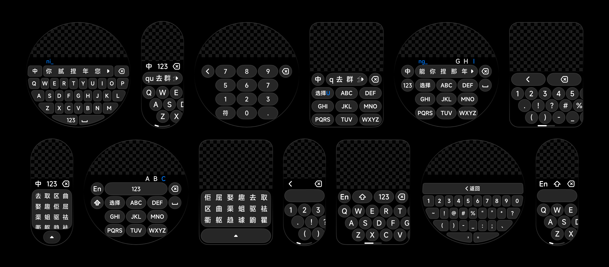

# Vela_input_method
 三⽅输⼊法组件

## 手动安装

### 下载项目代码

```bash
git clone https://github.com/NEORUAA/Vela_input_method.git
```

### 拷贝代码
把项目中的 `components` 文件夹拷贝到要使用组件的项目 src 目录下。然后就可以按照自定义组件的使用方式来使用本组件了。

由于 file.readText 方法暂不支持相对路径，默认词库路径为 `/components/InputMethod/assets/dictionary/`。如果组件放在其他目录，通过 `dictionarypath` 传入对应的包内绝对路径，以 `/` 结尾；

在宿主 `manifest.json` 的 `features` 中声明组件使用的接口（已有声明无需重复添加）：

```json
  { "name": "system.file" }
```

### 词库维护

生成的词库以 UTF-8 JSON 文本保存在 components/InputMethod/assets/dictionary/*.txt。部分 Vela 运行时读取包内 .json 文件会返回 202: invalid file type，因此词库资源使用 .txt 扩展名，运行时仍按需读取并通过 JSON.parse 解析。

原始词库位于 tools/dictionaries/，修改后运行以下命令重新生成包内资源并验证（这些工具和测试不用拷贝进宿主应用）：

```bash
node tools/build-dictionaries.cjs
node tests/dictionary-parity.cjs
node tests/dictionary-loader.cjs
```

---

## 组件名称
input-method

## 概述
输⼊法功能，支持中文拼音、英文和日语罗马字输入。日语候选可用于 `circle`、`rect` 和 `pill-shaped` 三种屏幕布局，目前仅支持 QWERTY 全键盘。

### 日语输入

点击语言按钮按“中文 → 英文 → 日语”切换，在 QWERTY 键盘上连续输入罗马字。候选栏先展示整段平假名和片假名，再展示整词、读音前缀补全及原有单字汉字候选；展开可查看全部候选。选择候选时只消耗该候选对应的罗马字，未完成的尾部继续保留。

| 罗马字 | 平假名 | 片假名 |
| --- | --- | --- |
| konnichiha | こんにちは | コンニチハ |
| nihongo | にほんご | ニホンゴ |
| gakkou | がっこう | ガッコウ |
| kya / shu / cho | きゃ / しゅ / ちょ | キャ / シュ / チョ |
| shi / si、chi / ti、tsu / tu、fu / hu | し、ち、つ、ふ | シ、チ、ツ、フ |
| nn、n（词尾）、n' | ん | ン |
| xya / lya、xtsu / ltsu | ゃ、っ | ャ、ッ |
| ko-hi- | こーひー | コーヒー |

`na`、`nya` 分别输入“な”“にゃ”，`kan'i` 输入“かんい”，`kani` 输入“かに”。转换遵循拼写，助词“は”需输入 `ha`，例如 `konnichiwa` 转为“こんにちわ”。

有组合输入时，空格提交首个候选；组合为空时输出空格。词库读取期间保留组合，待候选出现后再提交。日语 `123` 符号键盘保留当前组合，提供 `'`（分隔 `ん`）和 `-`（长音）；输入其他标点或数字会先提交当前假名及未完成尾部，再输出符号。删除键逐个删除罗马字，组合为空时触发宿主的 `delete` 事件。

支持离线整词与前缀补全，例如 `niho` 可补全“日本”“日本語”“にほんご”，`gakkou` 可选“学校”。完整读音优先于更长补全；选择候选只消耗已输入的对应罗马字。候选顺序固定，不记录最近输入或选词历史。原有单字候选仍保留，例如 `kanji` 可先选“漢”再继续输入剩余的 `ji`。当前没有句子级汉字转换或上下文语义预测；切换为 T9 时日语模式回到中文。

## ⼦组件
不⽀持

## 属性
| 名称 | 类型 | 默认值 | 必填 | 描述 |
| --------  | :----:  | :----:  | :----:  | :---- |
| dictionarypath | string | "/components/InputMethod/assets/dictionary/" | 否 | 词库目录的包内绝对路径，以 `/` 结尾；组件初始化时读取 |
| langlock | string | "" | 否 | 设为 `"jp"` 时初始化为日语并禁止切换语言；日语仍仅支持 QWERTY |
| jpkanaonly | boolean | false | 否 | 日语候选仅显示假名及假名整词补全，适用于读音搜索；提交偏移与候选一起过滤 |
| hide | boolean | true | 是 | 是否显⽰键盘（开发者可以通过切换属性值隐藏或者唤醒键盘） |
| keyboardtype | string | "QWERTY" | 否 | 键盘布局，"QWERTY" 表⽰全键，"T9" 表⽰九键。默认为 "QWERTY"（当 screentype 为 "pill-shaped" 时仅全键盘可用；日语暂不支持 T9） |
| maxlength | number | 5 | 否 | 默认展⽰的拼⾳候选词数量， maxlength > 0 时有效；点击展开查看所有候选词 |
| vibratemode | string | "" | 否 | 振动模式，""表⽰输⼊时不振动，"long" 表⽰⻓振动，"short" 表⽰短振动。默认为 "" |
| screentype | string | "circle" | 否 | 设备屏幕类型，"rect" 表示方形屏布局（对应 designWidth ≥ 336），"circle" 表示圆形屏布局（对应 designWidth 为 480），"pill-shaped" 表示胶囊形屏布局（对应 designWidth ≥ 192） |

## 事件
| 名称 | 参数 | 描述 |
| --------  | :-----  | :---- |
| complete | { detail: { content: string } } | 键盘输出字符时触发（当切换为中⽂输⼊法时候，当选中拼⾳对应⽂字时触发；当切换为英⽂输⼊法时，与 keyDown 触发条件⼀致）|
| delete | - | 键盘点击删除按钮触发 |
| keyDown | { detail: { content: string } } | 键盘按钮按下时触发 |
| visibilityChange | { detail: { visible: boolean } } | 键盘显示或隐藏时触发，visible 表⽰显示状态 |

## ⽰例代码
```html
<import name="input-method" src="../../components/InputMethod/InputMethod.ux"></import>
<template>
  <div class="page" style="flex-direction: column;">
    <text class="text" @click="changeState">
      {{textValue}}_
    </text>
    <input-method
      hide="{{hide}}"
      keyboardtype="{{keyboardtype}}"
      maxlength="5"
      vibratemode="{{vibratemode}}"
      screentype="{{screentype}}"
      @visibility-change="onVisibilityChange"
      @key-down="onKeyDown"
      @delete="onDelete"
      @complete="onComplete"
    ></input-method>
  </div>
</template>

<script>
export default {
  private: {
    textValue: "",
    hide: false,
    keyboardtype: "QWERTY", //QWERTY, T9
    vibratemode: "short",
    screentype: "circle", //pill-shaped, rect, circle
  },
  onVisibilityChange(evt) {
    console.log("显示状态变更:"+JSON.stringify(evt));
  },
  onKeyDown(evt) {
    // this.textValue += evt.detail.content;
    console.log("按下按键:"+JSON.stringify(evt));
  },
  onDelete() {
    this.textValue = this.textValue.slice(0, -1);
    console.log("删除字符");
  },
  changeState() {
    this.hide = !this.hide;
  },
  onComplete(evt) {
    this.textValue += evt.detail.content;
    console.log("返回字符:"+JSON.stringify(evt));
  },
};

</script>

<style>
.page{
  width:480px;
  height:480px;
}

.text{
  position:absolute;
  left:0;
  top:60px;
  width:100%;
  height:80px;
  text-align:center;
  color:white;
  background-color: red;
}
</style>
```
